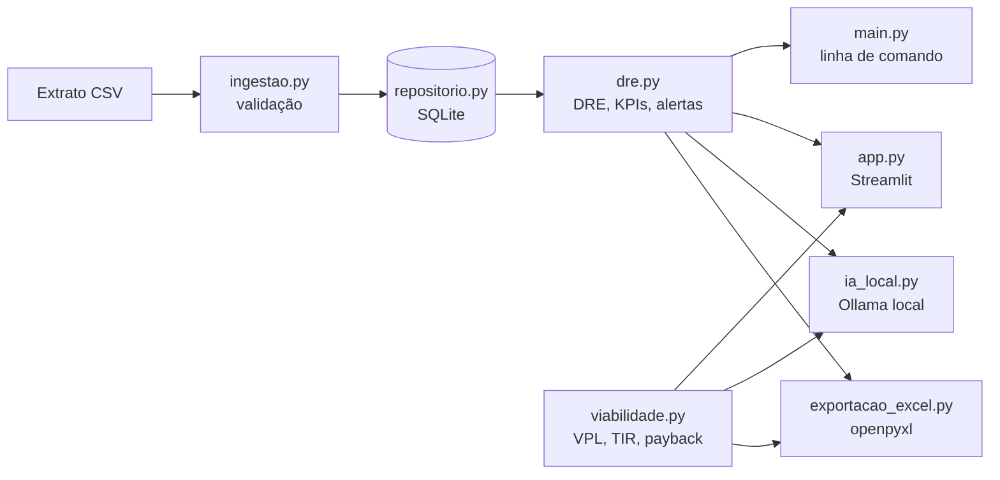

# Auto-FP&A · Motor de Inteligência Financeira


Um extrato financeiro em CSV vira **DRE Gerencial, ponto de equilíbrio, análise de viabilidade de investimentos (VPL, TIR e payback) e um parecer executivo escrito por IA**. A IA roda **localmente**, então os números da empresa não saem da máquina.

> Projeto de portfólio que une Python back-end e engenharia de dados com conceitos de controladoria e FP&A (*Financial Planning & Analysis*).

---

## O problema

Pequenas e médias empresas costumam decidir "no feeling". Sabem quanto faturaram, mas não sabem:

- quanto precisam faturar só para não ter prejuízo (**ponto de equilíbrio**);
- qual a folga entre o faturamento atual e esse limite (**margem de segurança**);
- se vale a pena comprar aquele equipamento ou sistema novo (**VPL e TIR**).

O Auto-FP&A responde essas perguntas em segundos a partir de um extrato que qualquer sistema financeiro já exporta.

## Funcionalidades

| Recurso | O que faz |
|---|---|
| **Ingestão robusta** | Aceita CSV técnico (`,` e ponto decimal) ou exportado do Excel brasileiro (`;`, vírgula decimal, `dd/mm/aaaa`). Erros apontam a linha exata do arquivo. |
| **Histórico em SQLite** | Importação idempotente: reimportar o mesmo extrato não duplica dados, e meses novos se somam ao histórico. |
| **DRE Gerencial** | Receita bruta → receita líquida → margem de contribuição → EBITDA, mês a mês. |
| **Indicadores** | Índice de MC, margem operacional, ponto de equilíbrio e margem de segurança (R$ e %). |
| **Alertas automáticos** | Sinaliza prejuízo, faturamento abaixo do ponto de equilíbrio e margem de segurança abaixo do limite configurado. |
| **Viabilidade (Capex)** | VPL, TIR, índice de lucratividade, payback simples e descontado, e sensibilidade do VPL à TMA. |
| **CFO Virtual (IA local)** | Envia um prompt estruturado ao **Ollama** (Llama 3, Mistral etc.) e devolve um parecer executivo. Endpoints remotos são bloqueados por padrão. |
| **Excel executivo** | Planilha com fórmulas vivas, alerta vermelho de margem de segurança (formatação condicional ligada a uma premissa editável), gráfico, Capex, alertas e o parecer. |
| **Painel web** | Streamlit com upload do CSV, gráficos interativos, simulador de investimento com controles deslizantes e download do Excel. |

## Arquitetura



Cada módulo tem uma responsabilidade só. O núcleo financeiro (`dre.py` e `viabilidade.py`) é feito de **funções puras**, sem banco nem tela, o que deixa tudo testável e reaproveitável por uma API no futuro.

```
auto-fpa/
├── app.py                    # Painel Streamlit
├── main.py                   # Interface de linha de comando
├── auto_fpa/
│   ├── config.py             # Configuração por variáveis de ambiente
│   ├── ingestao.py           # Leitura e validação do CSV
│   ├── repositorio.py        # Persistência SQLite idempotente
│   ├── dre.py                # DRE, indicadores e alertas
│   ├── viabilidade.py        # VPL, TIR, IL, paybacks e sensibilidade
│   ├── ia_local.py           # Cliente Ollama e prompt do CFO Virtual
│   ├── exportacao_excel.py   # Relatório executivo .xlsx
│   └── formatacao.py         # R$ e % no padrão brasileiro
├── data/                     # Dois cenários fictícios de exemplo
├── tests/                    # 35 testes automatizados (pytest)
└── .github/workflows/ci.yml  # Lint e testes a cada push
```

## Como rodar

```bash
git clone https://github.com/Marcospimentaadv/auto-fpa.git
cd auto-fpa
python -m venv .venv
source .venv/bin/activate        # Windows: .venv\Scripts\activate
pip install -r requirements.txt
```

**Painel web**

```bash
streamlit run app.py
```

**Linha de comando**

```bash
python main.py                                       # cenário de crescimento
python main.py --csv data/cenario_estresse.csv       # cenário com alertas
python main.py --investimento 80000 --fluxos 20000 25000 30000 35000 --tma 0.12
python main.py --ia --modelo mistral                 # inclui o parecer da IA
```

O relatório Excel é salvo em `saida/relatorio_fpa.xlsx`.

### Ativando o CFO Virtual (opcional)

1. Instale o [Ollama](https://ollama.com).
2. Baixe um modelo: `ollama pull llama3`.
3. Deixe o servidor rodando: `ollama serve`.

Sem o Ollama, o restante do sistema funciona normalmente e o painel avisa que a IA está offline.

| Variável de ambiente | Padrão |
|---|---|
| `OLLAMA_URL` | `http://localhost:11434` |
| `OLLAMA_MODEL` | `llama3` |
| `AUTOFPA_DB` | `data/auto_fpa.db` |

## Formato do CSV

```csv
data,descricao,categoria,tipo,valor
2026-01-05,Faturamento Serviços B2B,Receita Bruta,Entrada,85000.00
2026-01-10,Impostos sobre Faturamento,Impostos,Saida,9350.00
```

Categorias aceitas: `Receita Bruta` (Entrada), `Impostos`, `Custo Variavel` e `Despesa Fixa` (Saida). Os valores são sempre positivos, porque o sinal contábil vem da categoria.

## Conceitos financeiros aplicados

| Indicador | Fórmula | Leitura |
|---|---|---|
| Margem de Contribuição | Receita líquida − custos variáveis | Quanto cada venda sobra para pagar a estrutura |
| Índice de MC | MC ÷ receita bruta | Fração de cada R$ 1 vendido que vira contribuição |
| Ponto de Equilíbrio | Despesas fixas ÷ índice de MC | Faturamento em que o lucro operacional é zero |
| Margem de Segurança | (Receita − PE) ÷ receita | Quanto as vendas podem cair antes do prejuízo |
| VPL | Σ FCₜ ÷ (1 + TMA)ᵗ − investimento | Valor criado acima da rentabilidade mínima exigida |
| TIR | Taxa em que o VPL = 0 | Rentabilidade intrínseca do projeto |
| Payback descontado | Tempo até o saldo descontado ficar ≥ 0 | Prazo real de retorno, já considerando o custo do dinheiro |

## Testes e qualidade

```bash
pip install -r requirements-dev.txt
pytest          # 35 testes: ingestão, DRE, viabilidade, banco, IA (mock), Excel e painel
ruff check .    # lint
```

Os testes conferem os números contra cálculos manuais. Um exemplo: no ponto de equilíbrio, a margem de contribuição precisa ser igual às despesas fixas, e a TIR encontrada precisa zerar o VPL. O GitHub Actions roda tudo em Python 3.10 e 3.12 a cada push.

## Decisões técnicas

- **Privacidade por padrão:** o cliente de IA recusa qualquer endpoint fora de `localhost`. Para dados financeiros, essa é a diferença entre uma ferramenta que pode e uma que não pode ser usada numa empresa de verdade.
- **Importação idempotente:** `INSERT OR IGNORE` com chave única, no lugar de apagar a tabela a cada carga, preserva o histórico e evita duplicidade.
- **Ponto de equilíbrio defensivo:** com margem de contribuição nula ou negativa, o PE fica indefinido e gera alerta crítico, em vez de um número negativo ou infinito enganoso.
- **VPL como critério de decisão:** a TIR pode não existir ou ser múltipla em fluxos não convencionais, então o parecer se baseia no VPL.
- **Lógica separada da apresentação:** os cálculos retornam números; a formatação em R$ e % acontece só na borda (tela, Excel e prompt).

## Próximos passos

- [ ] API REST com FastAPI para integrar com ERPs
- [ ] Docker Compose com Ollama e o painel
- [ ] Projeção de fluxo de caixa (forecast) com séries temporais

## Autor

**Marcos Vinícius Pimenta**, estudante de Análise e Desenvolvimento de Sistemas, focado em back-end com Python, dados e IA.
[LinkedIn](https://linkedin.com/in/marcosvpimenta) · [GitHub](https://github.com/Marcospimentaadv)

Os dados de exemplo são fictícios.
